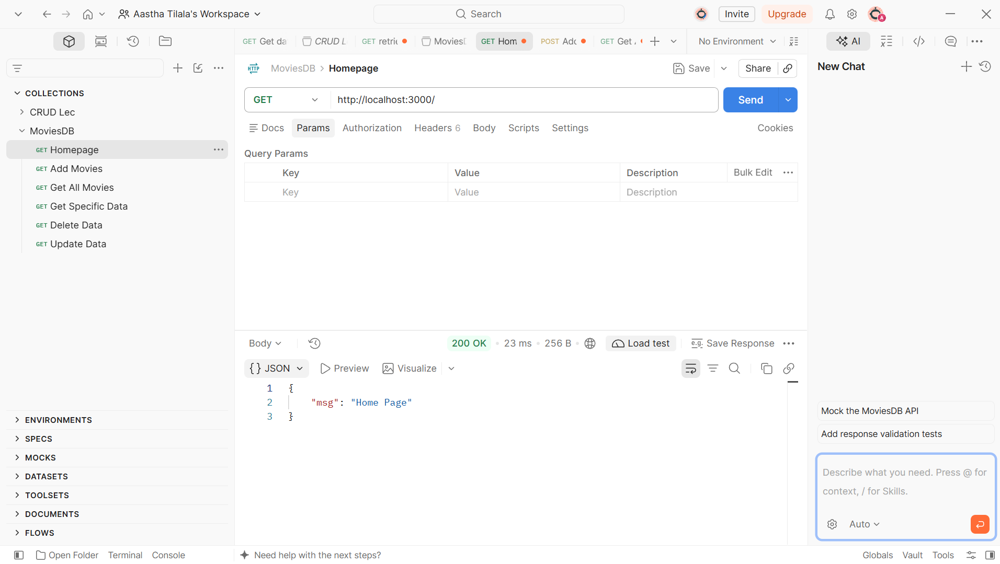
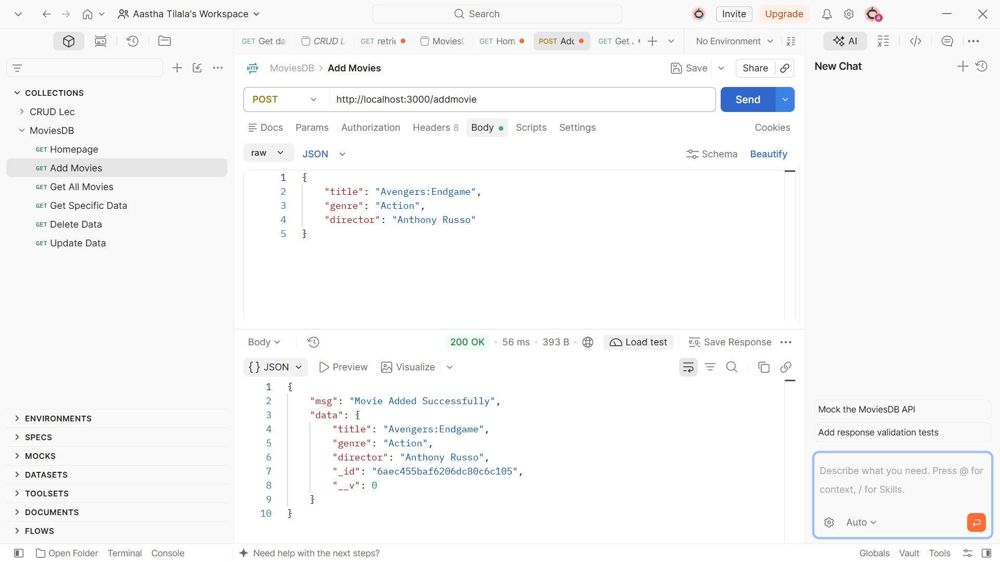
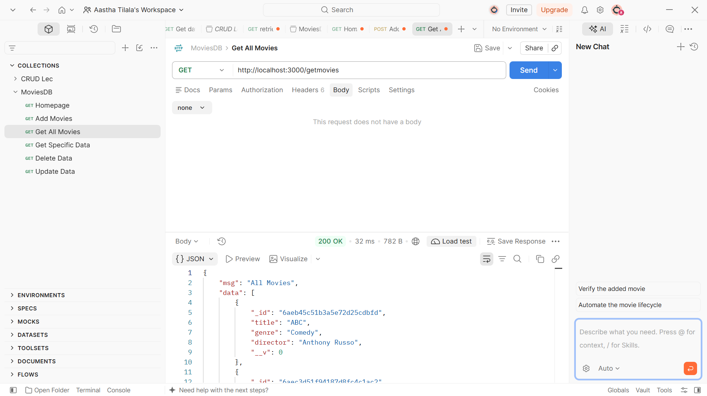
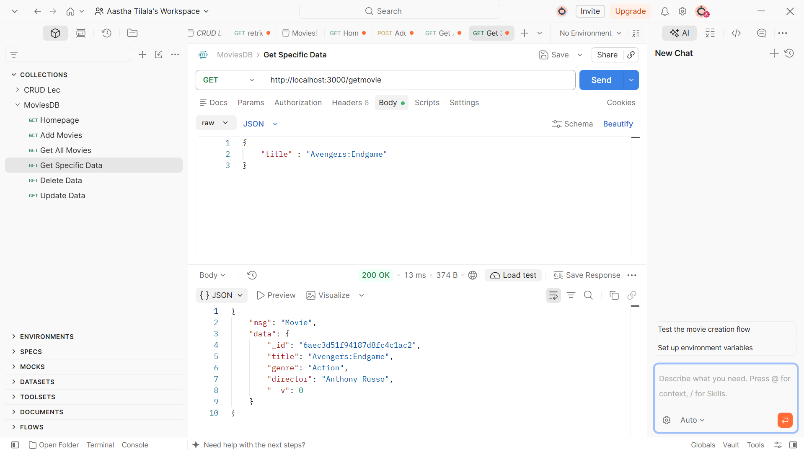
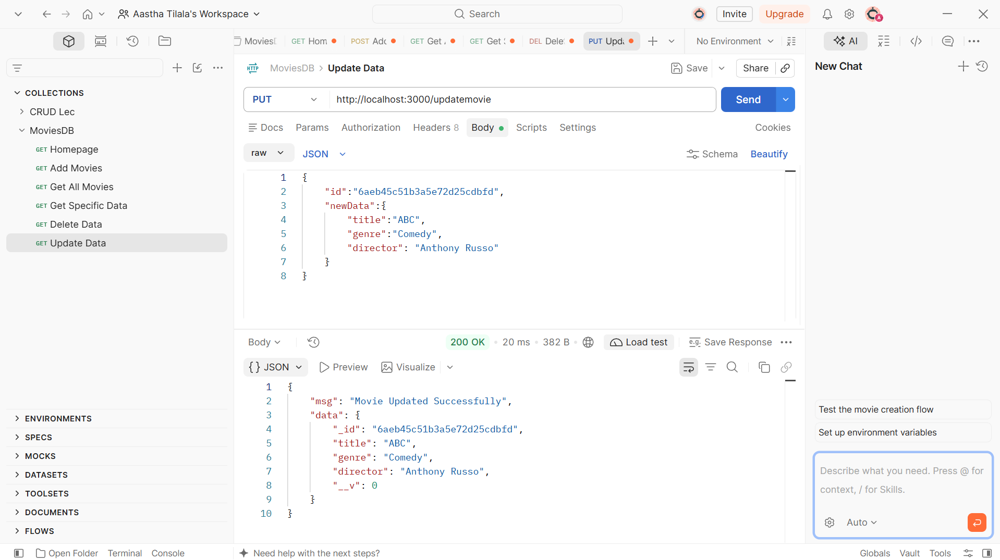
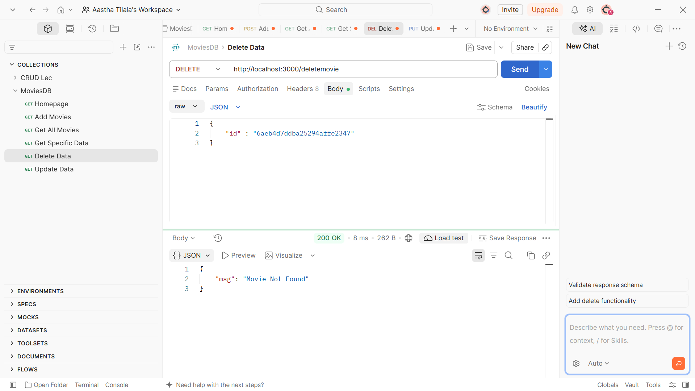

<h1 align="center">🎬 MOVIE MANAGEMENT API</h1>

<h3 align="center">✨ CRUD Operations Using Node.js, Express.js & MongoDB ✨</h3>

<p align="center">
  
  
  
</p>

<p align="center">
  
  
  
</p>

---

## 🌈 ABOUT THE PROJECT

🎥 **Movie Management API** is a backend project developed using Node.js, Express.js, MongoDB and Mongoose.

This project performs CRUD operations to manage movie records efficiently.

Users can add, view, search, update and delete movie details using REST API endpoints.

---

## 💻 TECHNOLOGIES USED

| Technology | Purpose |
|:---|:---|
| 🟢 Node.js | JavaScript Runtime |
| ⚡ Express.js | Backend Framework |
| 🍃 MongoDB | NoSQL Database |
| 🔗 Mongoose | Database Connectivity |
| 🧪 Postman | API Testing |

---

## ✨ PROJECT FEATURES

| Feature | Description |
|:---|:---|
| ➕ Add Movie | Add new movie details |
| 📋 Get All Movies | Display all movies |
| 🔍 Get Movie | Search a specific movie |
| ✏️ Update Movie | Update movie details |
| 🗑️ Delete Movie | Delete movie records |

---

## 🔥 CRUD OPERATIONS

<p align="center">
  
  
  
  
</p>

### 🔗 API ENDPOINTS

| No. | Method | Endpoint | Operation |
|:---:|:---:|:---|:---|
| 1 | POST | `/addmovie` | Add Movie |
| 2 | GET | `/getmovies` | Get All Movies |
| 3 | GET | `/getmovie` | Get Specific Movie |
| 4 | PUT | `/updatemovie` | Update Movie |
| 5 | DELETE | `/deletemovie` | Delete Movie |

---

## 📸 PROJECT SCREENSHOTS

### 🏠 1. HOME PAGE

<p align="center">
  
</p>

### ➕ 2. ADD MOVIE

<p align="center">
  
</p>

### 📋 3. GET ALL MOVIES

<p align="center">
  
</p>

### 🔍 4. GET SPECIFIC MOVIE

<p align="center">
  
</p>

### ✏️ 5. UPDATE MOVIE

<p align="center">
  
</p>

### 🗑️ 6. DELETE MOVIE

<p align="center">
  
</p>

---

## 🎥 PROJECT DEMO VIDEO

<p align="center">
  <a href="https://drive.google.com/file/d/14qmcXYGJYYkb35bfUHZznvhAbqMxEkSA/view?usp=sharing">
    
  </a>
</p>

<p align="center">
  🎬 Click above to watch the complete project demonstration.
</p>

---

## 📂 PROJECT STRUCTURE

```text
1stproject(03-11)/
│
├── 📁 images/
│   ├── addmovie.png
│   ├── deletemovie.png
│   ├── getmovie.png
│   ├── getmovies.png
│   ├── home.png
│   └── updatemovie.png
│
├── 📁 node_modules/
│
├── 📄 app.js
├── 📄 package-lock.json
├── 📄 package.json
└── 📄 README.md
```

---

## ⚙️ HOW TO RUN THE PROJECT

**1. Clone the repository**

```bash
git clone YOUR_GITHUB_REPOSITORY_LINK
```

**2. Open the project folder**

```bash
cd "1stproject(03-11)"
```

**3. Install dependencies**

```bash
npm install
```

**4. Start MongoDB**

Make sure your MongoDB server is running.

**5. Run the application**

```bash
node app.js
```

**6. Open your browser**

```text
http://localhost:3000/
```

---

## 📚 WHAT I LEARNED

- ✅ Creating a server using Express.js.
- ✅ Connecting MongoDB using Mongoose.
- ✅ Creating Schema and Models.
- ✅ Implementing REST API routes.
- ✅ Performing CRUD operations.
- ✅ Handling HTTP methods (GET, POST, PUT, DELETE).
- ✅ Sending and receiving JSON data.
- ✅ Testing APIs using Postman.

---

## 🚀 FUTURE IMPROVEMENTS

- 🔐 User Authentication.
- ⭐ Movie Ratings and Reviews.
- 🔍 Advanced Movie Search.
- 📑 Pagination.
- 🛡️ Improved Error Handling.

---

## 👩‍💻 DEVELOPER

<h2 align="center">💜 AASTHA TILALA 💜</h2>

<p align="center">
  🎓 Computer Engineering Student <br>
  💻 Full Stack Development Learner <br>
  🚀 Passionate About Learning New Technologies
</p>

---

<h2 align="center">🌟 THANK YOU FOR VISITING! 🌟</h2>

<h3 align="center">💖 KEEP LEARNING | KEEP BUILDING | KEEP GROWING 💖</h3>

<p align="center">
  ⭐ If you like this project, don't forget to give it a star!
</p>
